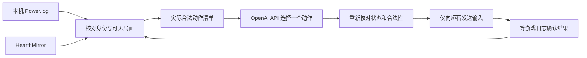

# Hearthstone AI for Mac

独立运行的 macOS 炉石 AI 项目。当前为 **0.1 人机测试版**，不是已验收的无人值守或排位产品。由用户在应用里启动和停止，运行过程不需要 Codex、聊天工具或远程桌面代理。

## 使用

1. 打开 `~/Applications/Hearthstone AI.app`。先退出炉石，保持接通电源；战网应已完成登录。
2. 在应用的安全输入框填写 OpenAI API Key，可选择保存在 macOS 钥匙串。不要把密钥放进项目文件或聊天。
3. 可先点「离线自检」。它不连接 API、不启动游戏，不能替代实战验收。
4. 点「开始人机测试」。程序建立资源保护、启动炉石、进入已校准的练习入口和动物园术卡组，再根据实际日志决策和执行。若系统要求辅助功能权限，请由用户通过应用按钮设置。
5. 「停止」或退出应用会停止本次任务，并关闭本次启动的游戏。API 错误、失去游戏焦点、数据不一致、未知界面和资源超限同样停止。

本机依赖：macOS 13+、Python 3.12+（本机已有 Homebrew Python 3.14）、炉石、已安装的 HSTracker/HearthMirror。API 模式不依赖 Java/Maven，也不要求 HSTracker 的叠层正常显示。仍需验证新应用身份下的辅助功能与 HearthMirror 权限。

## 决策和执行

默认模型为可更改的 `gpt-5.6-terra`，使用 [Responses API 的严格函数调用](https://developers.openai.com/api/docs/guides/function-calling)。模型只能选择本机已列出的动作，不能输出任意坐标、执行 shell 或打开其他应用。卡牌描述来自本地卡牌资料；未知的随机结果由游戏实际执行后再读取。配置默认模型的依据见 [官方模型说明](https://developers.openai.com/api/docs/models/gpt-5.6-terra)，模型权限与费用取决于用户的 API 账户。

发送内容限定为双方公开场面、本方手牌、相关卡牌文本和合法动作；不发送账号标识、对手隐藏手牌、截图、原始日志或密钥以外的本机凭据。密钥仅用于对 `api.openai.com` 进行认证，配置通过进程 stdin 传递，不进入 argv 或日志。请求设置 `store: false`，这不代表豁免 API 服务自身的数据保留规则。

## 当前上限

- 一次只运行一个人机测试，不自动重开、排位、购买或制作卡牌。
- 游戏最长运行 300 秒；启动和清理另有有界时间。最多 40 次 API 请求、每次最多 1536 输出 token，按请求输入字节上界与已报告使用量预留 120000 token 的会话预算。不自动重试付费请求。此预算不是美元账单上限，API 账户还应设置自身额度。
- API 网络子进程 18 秒超时；返回后重新校验完整局面，失效建议不执行。
- 游戏暂设 30 FPS，退出恢复原值。采样游戏内存上限 1800 MiB、AI 子进程组 200 MiB，并检查 CPU、系统内存压力、热状态、交换空间、磁盘余量、电源和电量。
- 保留最近五次本应用测试记录；每次原始对局日志最多 8 MiB，仅本地保存。

这些是采样停止机制，**不是内核硬限制，也不保证电脑不会发热**；未测量 GPU 功耗或实际芯片温度。此前导致卡死的确切原因仍未查明。

## 已完成与未验收

已实现原生应用、钥匙串配置、独立会话管理、API 适配、动作约束、状态重验、进程回收、离线自检和测试套件。之前的原型在真实练习局确认过出牌、目标选择、发现和结束回合，但这些证据不等于新 API 应用已通过完整对局。

**尚未完成：真实 API 连通与完整人机对局验收、稳定性连续测试、棋力评估、其他窗口尺寸、排位支持。** 当前只支持曾校准的游戏窗口 `(x=0,y=33,w=1470,h=846)`，卡组 ID 为 `3384315883`。起手暂时全部保留；地点、武器、未支持的奥秘或界面会停止。Practice 日志的 `FT_WILD` 不能当成已支持标准排位。

项目验收任务见 [PROJECT.md](PROJECT.md)，构建和测试见 [docs/DEVELOPMENT.md](docs/DEVELOPMENT.md)。

## 来源

解析器基于 MIT 许可的 [hearthstone-cli](https://github.com/OstrichHermit/hearthstone-cli/tree/6b0d50ae74f42e812bdf658e9d597fe74dd4ab65)，许可随 `runtime/state-upstream/LICENSE` 保留。HearthMirror 来自用户安装的 HSTracker，未复制其框架进入应用。之前抽取的 Java MCTS 不属于本应用的运行依赖。
