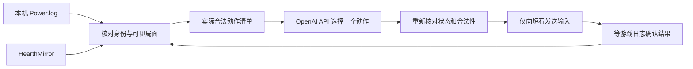

# Hearthstone AI for Mac

独立运行的 macOS 炉石 AI 项目。当前为 **0.2 测试版**，包含自动标准天梯和人机练习入口，尚未完成连续稳定性验收。由用户在应用里启动和停止，游戏决策与执行不依赖当前聊天。另有每 15 分钟的 Codex 复盘任务，读取已完成对局，必要时在局间改进程序。

## 使用

1. 打开 `~/Applications/Hearthstone AI.app`。先退出炉石，保持接通电源；战网应已完成登录。
2. 在应用的安全输入框填写 OpenAI API Key，可选择保存在 macOS 钥匙串。不要把密钥放进项目文件或聊天。
3. 可先点「离线自检」。它不连接 API、不启动游戏，不能替代实战验收。
4. 点「开始自动天梯」。程序建立资源保护、启动炉石、核对标准模式与完整动物园牌表，再根据实际日志决策和执行；正常结束后继续下一局。不设局数、对局时长、动作数或累计 API 调用/token 上限。「人机练习」只进行一局练习，便于单独验收。
5. 「打完这局停止」会等当前对局结束后停止排队；「立即停止」或退出应用立即回收本次启动的进程。API 错误、持续失去游戏焦点、数据不一致、未知界面和资源超限同样停止。若系统要求辅助功能权限，请通过应用按钮设置。

自动天梯已直接接入原生按钮，无需开发脚本排队。开局前核对选牌界面为标准、动物园卡组 ID 与完整 30 张牌；进入对局后再核对日志和 Mirror 的天梯/标准标记。正常复盘不会停止连排；有故障或连续三败时先复盘。具体局间控制与记录见 [连续运行](docs/CONTINUOUS-PLAY.md)。

**当前仍需要炉石处于前台，并占用真实鼠标。** 切换到其他应用会停止输入及本次运行；关闭客户端不会暂停服务器上的对局，可能损失回合。首次天梯尝试因开局读取时序与焦点问题中断，没有完整胜负验收。后台定向输入的三次菜单试验没有令炉石响应，尚未接入生产，详见 [后台输入验证](docs/BACKGROUND-INPUT.md)。

本机依赖：macOS 13+、Python 3.12+（本机已有 Homebrew Python 3.14）、已登录的战网、炉石、已安装的 HSTracker/HearthMirror。API 模式不依赖 Java/Maven，也不要求 HSTracker 的叠层正常显示。本机已验证新应用的辅助功能权限、钥匙串读取和 HearthMirror 场景读取。

## 决策和执行

当前选用可更改的 `gpt-6.1-sol`，使用 [Responses API 的严格函数调用](https://developers.openai.com/api/docs/guides/function-calling)。模型只能选择本机已列出的动作，不能输出任意坐标、执行 shell 或打开其他应用。如果已核对的动作清单仅剩结束回合，直接执行，不付费调用模型。卡牌描述来自本地卡牌资料；卡扎库斯审判根据本局观测到的两个组件还原文本；未知的随机结果由游戏实际执行后再读取。模型选择依据是本项目的实际盲测，见 [棋力改进记录](docs/TRAINING.md)。模型权限与费用取决于用户的 API 账户。

发送内容限定为双方公开场面、本方手牌与所选牌表、公开出牌记录、相关卡牌文本、对局策略与合法动作；不发送账号标识、对手隐藏手牌、截图、原始日志或密钥以外的本机凭据。密钥仅用于对 `api.openai.com` 进行认证，配置通过进程 stdin 传递，不进入 argv 或日志。请求设置 `store: false`，这不代表豁免 API 服务自身的数据保留规则。

### 策略层

`strategy-pack.json` 包含完整动物园参考牌表，以及 11 类对局的起手建议、争场/进攻/续航计划和需要考虑的关键牌。卡组类型依据 [vS 第 360 期报告（2026-10-29）](https://www.vicioussyndicate.com/vs-data-reaper-report-360/) 与所链接的牌表；具体打法是根据卡牌规则提出的假设，尚未通过天梯胜率验证。只有相关职业的最多两个候选计划会进入请求，生成或复制的牌不直接当作原始牌表证据。快照超过七天或客户端版本变化后停止使用环境计划；没有后台联网抓取或无限轮询。

匹配现在还使用来源牌表中的卡牌与数量：11 个模板中 9 个核对为 30 张，另 2 个来源列表不完整或展开方式未确认，明确标记。只输出最多两个候选、匹配/不匹配的原生出牌及「假如模板成立，尚未见到的关键牌数量」，不将排名分数当作概率，也不把未见牌当作对手已知手牌。换科技卡、未收录卡组和生成牌始终是可能性。

模型会拿到当前费用、已装备武器、可见附魔、牌库/手牌数量、公开特征牌和最近确认的动作。公开亮明或从场上回手的敌方卡牌带来源记忆，洗回牌库或身份变化后撤销；隐藏奥秘只给数量、实体标识和已经发生的试探，只有先前公开确认过的身份才作为已知奥秘。没有读取对手隐藏手牌，也没有实现完整奥秘排除规则引擎。发现选择使用完整局面；多阶段卡扎库斯选择保留同一来源已确认的组件。己方剩余牌组成只有在开局牌表、原始出牌、生成入库牌与当前牌库总数全部核对后才标记已核对，否则仍是估算。固定牌组知识放在请求前部，尚未测量实际缓存收益。

每局 `decisions.jsonl` 保存建议与游戏确认两个独立事件，以便检查错误决策。八题 A/B 评测覆盖直接斩杀、漂浮教程的当前费用、污亵二次伤害、冻结保命、己方加费顺序，以及三个发现局面；其中加费顺序是节奏偏好题，其余按明确局面条件判定。每题一次不能代替统计棋力或实战胜率。

首轮真实 `gpt-6.1-terra` 评测结果为原版 6/8、新版 8/8，决策中位耗时约 2.13/2.10 秒。新版两道改进题分别是发现中的确定斩杀和濒死满场时的解场回血；新版也使用了更多输入 token。完整用量和局限见 [验证记录](docs/VALIDATION.md)。

后续三模型基础比较淘汰了本组明显落后的 Luna。复杂题 Sol 65/72、Terra 62/72，迁移题继续偏向 Sol，因此当前改用 Sol；这些人工小样本评分不是胜率。法力和当前卡牌费用来自日志，本地计算器补充硬币收益、十费溢出与加费变化；满足严格条件的凝视保命目标也由本地算术决定。每次运行保存胜负或未完成结果，并把未确认动作、输局留到有界复盘队列。所谓训练是改进程序规则和策略，没有声称改变模型权重。

## 连续运行与资源保护

- 自动天梯持续连排，不设局数、对局时长、动作数或累计 API 配额；不购买或制作卡牌。每局结束后完成清理、保存结果，间隔 10 秒再启动下一局。
- 单次请求仍有 64000 字节输入上界、1536 输出 token 上界；网络、启动及动作确认保留超时。记录实际使用量，不自动重试付费请求，也不把 token 用量当作已核对的美元账单。
- API 网络子进程 18 秒超时；返回后重新校验完整局面，失效建议不执行。
- 游戏暂设 30 FPS，退出恢复原值。采样游戏内存上限 1800 MiB、AI 子进程组 200 MiB，并检查 CPU、系统内存压力、热状态、交换空间、磁盘余量、电源和电量。
- 系统内存压力进入 critical、可用内存指标低于 20%，或交换空间相对连续运行开始增长超过 256 MiB，都会停止。连续天梯各局共用同一增长基线，清理或换局不会重置；历史 swap 总量不再单独阻止启动，warning 记录并通过局间清理处理。
- 保留最近五次本应用测试记录；每次原始对局日志最多 8 MiB，会话事件最多 1 MiB，决策复盘最多 2 MiB，仅本地保存。
- 另保留最近 50 条对局汇总和最多 10 个公开局面待复盘记录，不无限积累原始日志。

这些是采样停止机制，**不是内核硬限制，也不保证电脑不会发热**；未测量 GPU 功耗或实际芯片温度。此前导致卡死的确切原因仍未查明。

## 已完成与未验收

已实现原生应用、钥匙串配置、独立会话管理、API 适配、动作约束、状态重验、进程回收、离线自检和测试套件。之前的原型在真实练习局确认过出牌、目标选择、发现和结束回合，但这些证据不等于新 API 应用已通过完整对局。

真实 `gpt-6.1-terra` API、起手确认、出牌、攻击、目标选择、发现和结束回合已有独立应用的实际日志证据。2026-11-01 完成一次从主菜单到 `WON` 的不中断练习局：23 个动作、18 次 API 请求、71675 token；另一次中途重连接回的练习局也获胜。Sol 后续人机测试确认硬币的本地法力计算与实测一致，并完成一次中途重连的胜局。150 项单元测试和 4 道真实 Sol API 公开信息使用题通过。**尚未完成：连续稳定性、实战棋力统计和其他窗口尺寸。** 标准天梯实际结果以 [验证记录](docs/VALIDATION.md) 为准。当前只支持窗口 `(x=0,y=33,w=1470,h=846)`，卡组 ID 为 `3384315883`。起手暂时全部保留；地点或不支持的界面会停止。奥秘状态会提供给 AI，但不保证所有奥秘应对正确。武器可以作为公开信息读取，不支持从手牌装备武器。Practice 日志的 `FT_WILD` 不属于标准天梯证据。

项目验收任务见 [PROJECT.md](PROJECT.md)，构建和测试见 [docs/DEVELOPMENT.md](docs/DEVELOPMENT.md)。

## 来源

解析器基于 MIT 许可的 [hearthstone-cli](https://github.com/OstrichHermit/hearthstone-cli/tree/6b0d50ae74f42e812bdf658e9d597fe74dd4ab65)，许可随 `runtime/state-upstream/LICENSE` 保留。HearthMirror 来自用户安装的 HSTracker，未复制其框架进入应用。之前抽取的 Java MCTS 不属于本应用的运行依赖。
